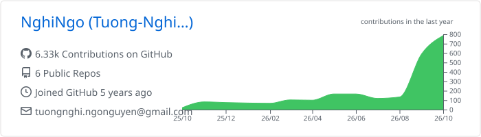
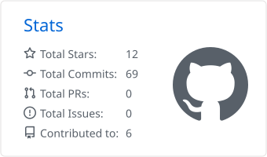
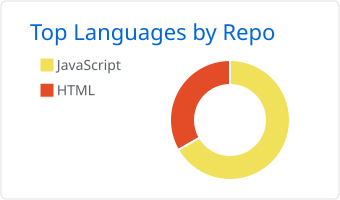

<h1 align="center">Hi, I'm Tuong-Nghi Ngo (Ngô Nguyễn Tường Nghi) 👋</h1>

  <b>Lecturer · Researcher · Software Engineer</b> 
  Department of Information Technology, Nha Trang University 🇻🇳

  
  
  <!-- Add when ready:
  
  -->

---

### 🔭 About me

I teach and build software at Nha Trang University, where I try to keep research and real-world engineering close together. My current research centres on **Retrieval-Augmented Generation (RAG)** — in particular, how to represent semi-structured and tabular data so LLM-based systems retrieve the right context.

- 🔬 **Researching:** RAG optimisation, context injection, semi-structured data flattening
- 👨‍🏫 **Teaching:** Software Testing · Object-Oriented Programming with C# · Digital Skills
- 🎓 **Also:** supervising student theses and graduation projects

### 🧠 Research & teaching interests

| Area | Topics |
|---|---|
| **AI / NLP** | Large Language Models, RAG, embeddings for tables in mixed documents, explainable recommendation |
| **Software Engineering** | Software testing, database systems (PostgreSQL + pgvector), containerised deployment, web architecture |
| **Academic practice** | IT curriculum design, scientific writing with LaTeX / Beamer |

### 🛠️ Tech stack

  

### 📄 Selected publications

**1. Optimising retrieval in RAG systems via active context injection and semi-structured data flattening** (2026)
 *Tối ưu hóa truy xuất trong hệ thống RAG thông qua kỹ thuật bổ sung ngữ cảnh chủ động và làm phẳng dữ liệu bán cấu trúc*

A data-representation layer for RAG that tackles context loss in semi-structured JSON. Combines **Natural Language Flattening (NLF)** with **Active Context Injection (ACI)**, reaching **85.56% Context Precision** under RAGAS evaluation.
 `AnythingLLM` `Docker` `Gemini Embedding` `Llama-3.1-8B` `RAGAS`
 📦 [Code](https://github.com/NghiNgo/RAG-Context-Injection) <!-- · 📑 [Paper](DOI_LINK) -->

**2. A car recommendation system combining content-based filtering and large language models** (2025)
 *Hệ thống gợi ý xe ô tô kết hợp nội dung và mô hình ngôn ngữ lớn*

A hybrid content-based recommender using 897-dimensional feature vectors (structured metadata + 768-D text embeddings), with Google Gemini generating natural-language explanations (XAI).
 `Python` `FastAPI` `PostgreSQL` `pgvector (HNSW)` `Gemini`
 📦 [Code](https://github.com/NghiNgo/CBF-XAI) <!-- · 📑 [Paper](DOI_LINK) -->

### 📊 GitHub stats

  <picture>
    <source media="(prefers-color-scheme: dark)" srcset="./profile-summary-card-output/github_dark/0-profile-details.svg">
    
  </picture>

  <picture>
    <source media="(prefers-color-scheme: dark)" srcset="./profile-summary-card-output/github_dark/3-stats.svg">
    
  </picture>
  <picture>
    <source media="(prefers-color-scheme: dark)" srcset="./profile-summary-card-output/github_dark/1-repos-per-language.svg">
    
  </picture>

### 🐍 Contribution activity

  <picture>
    <source media="(prefers-color-scheme: dark)" srcset="https://raw.githubusercontent.com/NghiNgo/NghiNgo/output/github-snake-dark.svg">
    
  </picture>

---

<i>Open to research collaboration on RAG, LLM applications, and software quality — feel free to reach out.</i>

