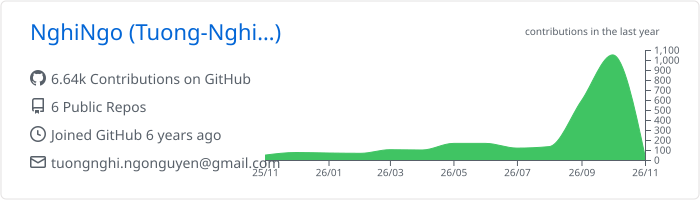
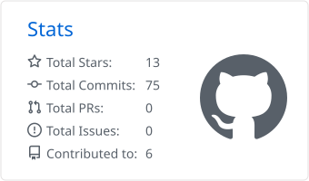
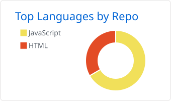

<h1 align="center">Tuong-Nghi Ngo (Ngô Nguyễn Tường Nghi)</h1>

  <b>Lecturer · Researcher · Software Engineer</b> 
  Department of Information Technology, Nha Trang University 🇻🇳

  
  
  <!-- Uncomment when ready:
  
  
  -->

---

### About

I teach and build software at **Nha Trang University**, bridging academic research with production engineering. My current research centres on **Retrieval-Augmented Generation (RAG)** — specifically how to represent semi-structured and tabular data so LLM-based systems retrieve accurate context.

| Pillar | Focus |
|---|---|
| **Research** | Large Language Models, RAG optimisation, active context injection, semi-structured data flattening, explainable recommendation (XAI) |
| **Teaching** | Software Testing · Object-Oriented Programming (C#) · Digital Skills · Student thesis & project supervision |
| **Engineering** | Database systems (`PostgreSQL` + `pgvector`), containerised deployment, web architecture, scientific writing (`LaTeX` / `Beamer`) |

---

### Selected publications & open source

#### 1. Optimising retrieval in RAG systems via active context injection and semi-structured data flattening `(2026)`
*Tối ưu hóa truy xuất trong hệ thống RAG thông qua kỹ thuật bổ sung ngữ cảnh chủ động và làm phẳng dữ liệu bán cấu trúc*

> A data-representation layer for RAG tackling context loss in semi-structured JSON. Combines **Natural Language Flattening (NLF)** with **Active Context Injection (ACI)**, achieving **85.56% Context Precision** under RAGAS evaluation.

`AnythingLLM` · `Docker` · `Gemini Embedding` · `Llama-3.1-8B` · `RAGAS`

<!--  -->

 

#### 2. A car recommendation system combining content-based filtering and large language models `(2025)`
*Hệ thống gợi ý xe ô tô kết hợp nội dung và mô hình ngôn ngữ lớn*

> A hybrid content-based recommender built on 897-dimensional feature vectors (structured metadata + 768-D text embeddings), paired with Google Gemini for natural-language explanations (XAI).

`Python` · `FastAPI` · `PostgreSQL` · `pgvector (HNSW)` · `Gemini`

<!--  -->

---

### Technical stack

| Domain | Technologies |
|---|---|
| **AI & Data** | `Python` · `FastAPI` · `PostgreSQL` · `pgvector` · `RAGAS` · `AnythingLLM` |
| **Application & Web** | `C# (.NET)` · `C++` · `Java` · `PHP` · `Laravel` · `WordPress` |
| **Infrastructure & Academic** | `Docker` · `Linux (Ubuntu)` · `Git & GitHub` · `LaTeX` |

   
  

-->

---

### GitHub activity

  <picture>
    <source media="(prefers-color-scheme: dark)" srcset="./profile-summary-card-output/github_dark/0-profile-details.svg">
    
  </picture>

  <picture>
    <source media="(prefers-color-scheme: dark)" srcset="./profile-summary-card-output/github_dark/3-stats.svg">
    
  </picture>
  <picture>
    <source media="(prefers-color-scheme: dark)" srcset="./profile-summary-card-output/github_dark/1-repos-per-language.svg">
    
  </picture>

  
<b>Contribution animation</b>

   
  

    <picture>
      <source media="(prefers-color-scheme: dark)" srcset="https://raw.githubusercontent.com/NghiNgo/NghiNgo/output/github-snake-dark.svg">
      
    </picture>
  

---

  <i>Open to research collaboration on RAG, LLM applications, and software quality — feel free to reach out.</i>

